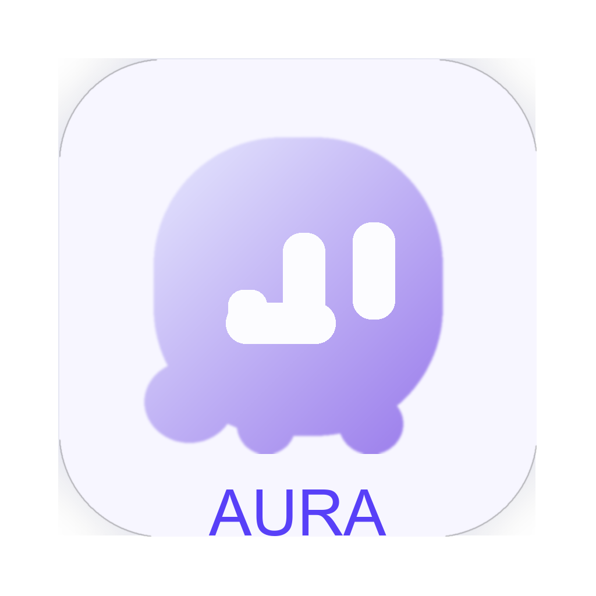
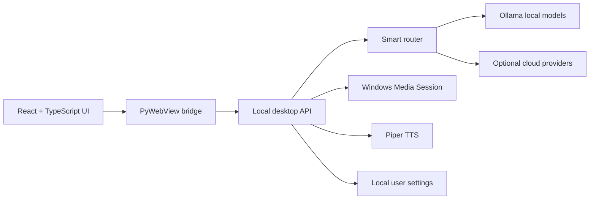

# AURA



**AURA is a lightweight, local-first desktop AI companion for Windows.** It combines a welcome-style chat workspace, local Ollama models, cloud-provider routing, voice input/output, reminders, calendar payments, news, media controls, and a movable companion.

## Highlights

- Local chat through Ollama with hardware-aware model recommendations.
- Natural commands for apps, web search, YouTube, weather, reminders, and media.
- Windows media-session support for YouTube, Spotify, browser playback, and compatible local players.
- Live track title, artist, artwork banner, playback state, progress, and controls.
- Piper TTS voice profiles with English and Malayalam support.
- Custom assistant name, user profile, location, API keys, theme, avatar, and wallpaper.
- Resizable and movable dashboard cards with saved layouts.
- Recurring payments connected to calendar dates and reminder colors.
- PyWebView desktop shell with a bundled one-click launcher.

## Architecture



## Resource profile

| Component | Default behavior | Resource goal |
| --- | --- | --- |
| UI | Vite production bundle | Small, GPU-friendly surface |
| Runtime | PyWebView + local HTTP bridge | No Electron runtime |
| AI | Ollama on demand | User-selectable local model |
| Voice | Piper only when requested | No continuous audio processing |
| Media | Lightweight polling | No permanent streaming service |

## Install

Download the latest Windows release from [Releases](https://github.com/sangeethsanthosh-git/AURA/releases). The first-run setup asks for your name, assistant name, location, optional API keys, voice, and a capable local model.

Ollama is optional for cloud-only use. For local models, install it from [ollama.com/download](https://ollama.com/download), then AURA can install or pull a compatible model.

## Development

```powershell
npm install
npm run desktop:dev
```

Run checks:

```powershell
npm run typecheck
python -m py_compile desktop_launcher.py
```

Build the device test executable:

```powershell
npm run desktop:build
```

Build the generic global release:

```powershell
npm run desktop:build:global
```

Output folders are configured in `package.json` and excluded from Git. Release binaries are distributed through GitHub Releases.

## Configuration and privacy

API keys and user preferences are stored locally by the desktop runtime. `.env.example` documents development configuration; secrets should never be committed. Local model files and voice assets are excluded from Git because they are large and platform-specific.

## License

Copyright (c) 2026 Sangeeth Santhosh. AURA is released under the [MIT License](LICENSE).
