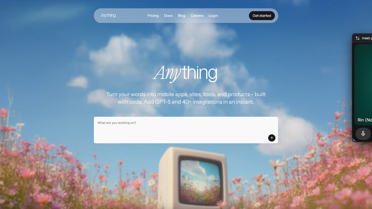
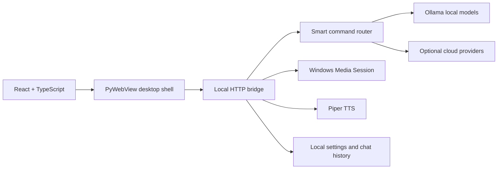
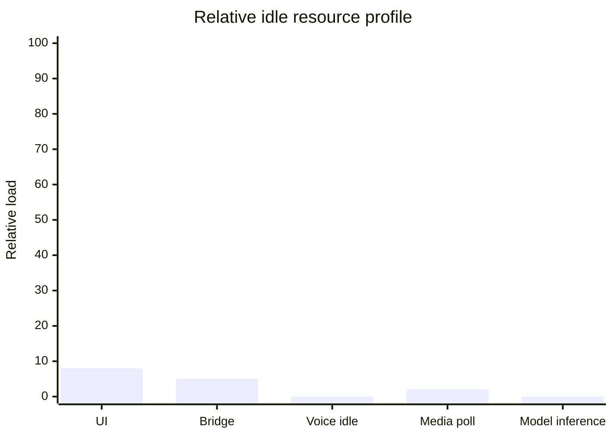
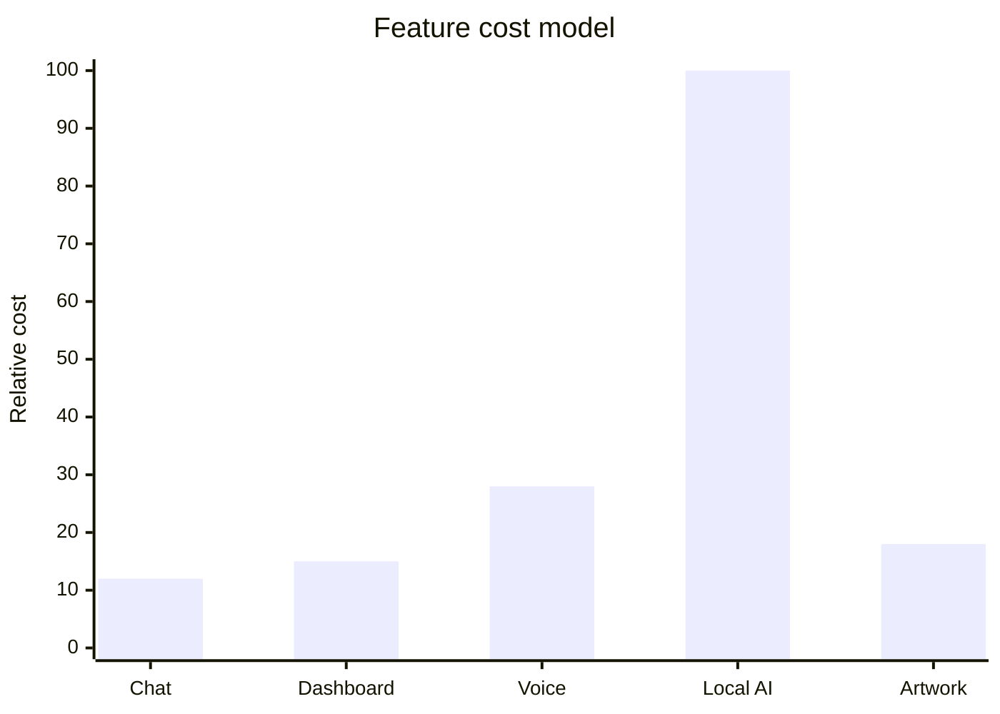

# AURA


**AURA is a lightweight, local-first AI companion for Windows.** It gives users one calm workspace for chat, voice, local models, reminders, calendar planning, news, media, and a customizable desktop companion.



## What AURA does

| Area | Features |
| --- | --- |
| Chat | Welcome-screen chat, conversation history, new chats, search, pin/archive/delete controls |
| AI | Ollama local models, hardware-aware recommendations, optional cloud-provider routing |
| Actions | Open apps, search the web, open YouTube, weather, reminders, files, and everyday commands |
| Voice | Voice input, Piper text-to-speech, English/Malayalam profiles, selectable voice tones |
| Companion | Optional movable companion, wake-word support where the browser permits it, expressions, sound feedback |
| Dashboard | Movable and resizable cards, custom notes/widgets, music, weather, profile, news, search, schedule, and payments |
| Calendar | Events, recurring payments, colored reminder dates, schedule cards, and upcoming items |
| Media | Windows media-session detection for YouTube, Spotify, browser playback, and compatible local players; title, artist, artwork, controls, and timeline when the player exposes them |
| Personalization | Assistant name, user name, age/DOB, location, account email, theme, avatar, wallpaper, model, and voice |
| Desktop | One-click PyWebView app, bundled frontend/backend, silent console-free launcher, setup wizard, Piper assets |

## Screenshots and visual assets

The project includes the AURA icon, welcome backgrounds, companion visuals, and the production app styling in [`public/assets`](public/assets). The welcome experience uses the AURA artwork as its visual identity and adapts to the selected theme.


## Architecture



## Performance profile

The application is designed to remain light when idle. Heavy work is opt-in: local model inference runs only for a request, voice processing runs only during voice use, and media metadata is polled at a low frequency.





These charts are design targets, not hardware benchmarks. Actual model memory and inference speed depend on the selected model, RAM, CPU, GPU, and Ollama configuration.

## Privacy and secrets

Some features require provider credentials. API keys are optional and are entered by the user during setup or later in Settings. They are stored locally by the desktop runtime and are not intended to be committed to Git.

Never commit:

- `.env` or real API keys
- Personal chat history or account details
- Ollama model files
- Piper voice binaries and downloaded media
- Generated executables, caches, logs, and build folders

Use [`.env.example`](.env.example) only as a development configuration template. Cloud providers are optional; AURA can run with Ollama alone after Ollama is installed.

## Installation

Download the Windows executable from the [AURA Releases page](https://github.com/sangeethsanthosh-git/AURA/releases). On first launch, the setup wizard collects the user profile, assistant name, location, optional API keys, voice preference, and a model suitable for the detected hardware.

For local AI, install [Ollama](https://ollama.com/download). AURA can then verify the runtime and guide the user to download a compatible model. Cloud-only use does not require Ollama.

## Development

```powershell
npm install
npm run desktop:dev
```

Checks:

```powershell
npm run typecheck
python -m py_compile desktop_launcher.py
```

Build the device test executable:

```powershell
npm run desktop:build
```

Build the generic global release:

```powershell
npm run desktop:build:global
```

The global executable is written to `C:\PROJECT\AURA GLOBAL EXE\AURA.exe` and should be distributed through GitHub Releases.

## License

Copyright (c) 2026 Sangeeth Santhosh. AURA is released under the [MIT License](LICENSE).
