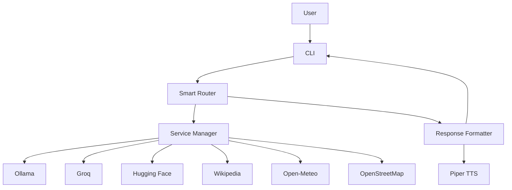

# AURA - Intelligent Personal Desktop Assistant


## Project Description

AURA is an offline-first intelligent desktop assistant built with Python. It combines local AI through Ollama, online AI providers such as Groq and Hugging Face, free public APIs, smart routing, response formatting, and Piper text-to-speech.

## Features

- CLI interface
- Local Ollama chat
- Groq programming support
- Hugging Face translation support
- Wikipedia knowledge lookup
- Open-Meteo live weather
- OpenStreetMap maps search
- Piper TTS
- Smart AI Router
- Intent Classifier
- Service Manager
- Logging and error handling

## Architecture



## Folder Structure

```text
backend/
  config/
  router/
  services/
  tests/
  utils/
docs/
  architecture/
  dfd/
  diagrams/
  presentation/
  reports/
  screenshots/
  uml/
  workflow/
```

## Installation

```bash
python -m venv .venv
.venv\Scripts\activate
pip install -r requirements.txt
```

Configure API keys in `.env`:

```text
GROQ_API_KEY=
HF_API_KEY=
```

## Usage

```bash
python app.py
```

Example commands:

```text
/weather Kochi
/wiki Alan Turing
/map Kochi
Write Python code to reverse a string
Translate hello to French
```

## Screenshots

Screenshot instructions are available in `docs/screenshots/Screenshot_Guide.md`.

## Roadmap

- Version 1: CLI backend
- Version 2: Electron desktop UI
- Version 3: SQLite, memory, and RAG
- Version 4: Voice assistant
- Version 5: Plugins
- Version 6: Major project / research version

## Future Scope

- Electron + React frontend
- Persistent memory
- SQLite
- RAG
- Voice input
- Calendar
- Notes
- Finance APIs
- Plugin system

## License

This project is intended for academic mini project and research use. Update the license section based on the repository license.
