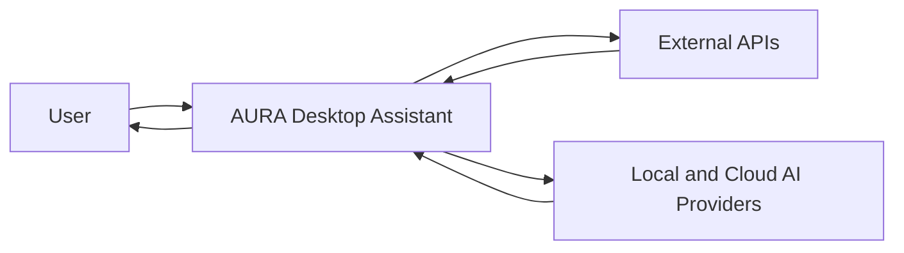

# DFD Level 0 - Context Diagram

## Description

The user interacts with AURA through the current CLI interface. AURA routes requests to local AI, cloud AI, and external APIs, then returns formatted text and speech output to the user.
